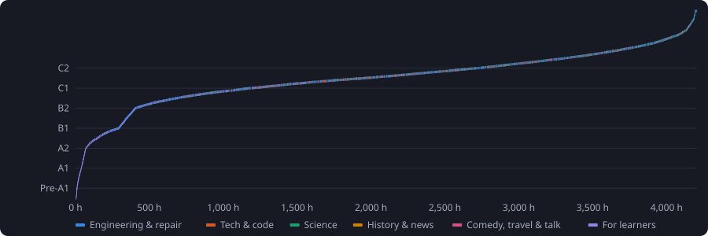

# spanish-immersion-path

A path through Spanish immersion videos on YouTube, ordered from easiest to hardest,
with an Anki deck that teaches the words of each video right after you watch it.

- [Progress page](https://tieo.github.io/spanish-immersion-path/): the difficulty curve
  and every video with its level, speed and number of new words; tick off what you have
  watched (stored in your browser)
- [Playlist on YouTube](https://www.youtube.com/playlist?list=PLHH8jQ4Q3nHE)

## The playlist

1,176 videos from three channels that teach through native speakers talking, not
through lessons:

- [Easy Spanish](https://www.youtube.com/@easyspanish): street interviews and the slow
  *Super Easy Spanish* conversations
- [Dreaming Spanish](https://www.youtube.com/@DreamingSpanish): comprehensible input
  from superbeginner to advanced
- [Spanish After Hours](https://www.youtube.com/channel/UCfG2VhlQgy5bHGmkpeKcjVA): slow
  vlogs and stories

Grammar lessons, vocabulary lists, videos in English, promos and compilations of other
videos are left out.

Every video is placed on the CEFR scale (A1 to C2) by a model fitted to recordings whose
level is known:

- the listening tasks of the official DELE sample exams (Instituto Cervantes), A1 to C2
- short talks by Spanish teachers from the
  [Explora audios](https://www.profe-de-espanol.de/explora-audios-banco-de-audios-para-la-clase-de-ele/)
  bank of profe-de-espanol.de, each recorded for a stated level

73 recordings in all, transcribed with Whisper. The model measures what makes listening
hard, the same way in a short recording and an hour-long video:

- **speaking rate**: syllables per second while someone speaks, pauses left out (from
  the word timings of YouTube's captions)
- **vocabulary**: the share of words at each CEFR level from A2 to C1, and of words no
  level lists, by [ELELex](https://cental.uclouvain.be/cefrlex/elelex/), a lexicon of
  the words in graded Spanish textbooks and readers (CENTAL, UCLouvain, CC BY-NC-SA 4.0)
- **sentence structure**: subordinate clauses per word
- **verb forms** and **pronouns**: past tenses, object pronouns (lo, le, se)

Vocabulary weighs most, then speaking rate and sentence structure. Scored by a fit that
has not seen them, the recordings come out in the order of their levels with a rank
correlation of 0.81; Dreaming Spanish's own labels, which the fit never uses, come out in
order with 0.73, superbeginner around A1 and advanced around B2. The median recording of
each level from A1 to B2 sits in the middle of that level on the scale; C1 and C2 have
too few recordings to pin it, so the scale runs on at the same slope. The curve above
shows every video as a bar along the hours of the playlist, as wide as the video is long
and as high as its level. The playlist runs in rising order of that score.

## The Anki deck

Each video gets a sub-deck of new words: the most widespread words of the playlist that
the video contains and no earlier video has taught yet, 30 per video and up to 40 when
the extra words come back nowhere later. The early videos fill that quota; further along,
most of what a video says has been taught already, so later videos bring a handful of new
words each (11,882 cards in all). The progress page can hide videos below a number of new
words. Words easier than a
video's cards were taught by earlier videos; the most common words, which make up half
of everything said, are taken as known. A card shows the word with its pronunciation
(IPA and a recording, Spain and Latin America), the meaning, a sentence from the video
with its translation, a link to that moment in the video, and links to the next videos
where the word comes back.

## Building it

The pipeline lives in `pipeline/`, the inputs it decides on in `data/`; everything
derived (captions, vocabulary, recordings, the deck) goes to `build/`, which stays out of
the repository because the captions are the channels' text.

1. `fetch_captions.py list`: the videos of the channels in `data/channels.json`; a
   language model sorts them into immersion and lessons by the rules in
   `pipeline/CLASSIFY.md` (`data/classes.json`); `fetch_captions.py fetch`: Spanish
   captions of the immersion videos (yt-dlp with browser cookies)
2. `measure.py`: parses every video once with spaCy (in parallel, only new videos on a
   rerun) into `build/measured.jsonl`; `graded.py transcribe`: word timings of the
   CEFR-graded recordings in `build/graded/` (Whisper; runs on an NVIDIA GPU with
   `WHISPER_DEVICE=cuda`); then `levels.py`: the fit, scores and watching order, written
   to `build/order.json` (it needs `build/ELELex.tsv`)
3. `words.py`: the words of each video, then `translate.py batches` and `merge` around
   the translators that follow `TRANSLATE.md`; rerun `words.py` after a merge so videos
   that lost dropped words refill
4. `ipa.py`, `audio.py`: pronunciation and recordings for Spain and Latin America
5. `deck.py`: `build/deck.apkg`, one sub-deck per video
6. `ankiweb.py push`: imports the deck into an AnkiWeb account, keeping review history
7. `site_data.py`: the data behind the progress page
8. `progress.py`: per-video Anki progress for the page, read from AnkiWeb; the Pages
   workflow runs it every three hours when the repository has an `ANKIWEB_HKEY` secret
9. `units.py`: `build/catalog.npz`, the catalog the learner's app picks units from, and
   `publish.py`, which copies it into the app's state directory
   (`SIP_PUBLISH=user@host:directory`); the app reads a new catalog without a restart
10. `vocab_check.py`: `data/vocab_check.json`, the words of the app's vocabulary check

## The learner's app

`server/` is a small web app (`python -m server.app`) that picks the next unit instead
of a fixed order. It keeps the learner's level on the same CEFR scale: every finished unit
is rated easy, just right or hard, which moves the level (several easy ones in a row move
it faster), and can be marked boring, which steers away from its series. Modes choose
what fits the moment: the best next step, audio only, or something relaxed.

Among the videos near the learner's level it prefers those where they know most of the
words, up to the 95% at which listening gets comfortable. Which words they know comes
from two places: their Anki reviews for the words in the deck, and a five-minute
vocabulary check for everything else, offered every four weeks. The check shows real
words from six frequency bands mixed with made-up words that look Spanish; "know" on a
made-up word shows how much a learner over-claims, the result is corrected for it, and a
curve of known words by frequency is fitted to the answers.

Anki holds every word of the path in one deck, suspended until a video the learner
finished introduces it. Claude can hold a spoken practice conversation through the
app's MCP endpoint, which hands it the learner's level, the words they are learning and
their recurring errors.
