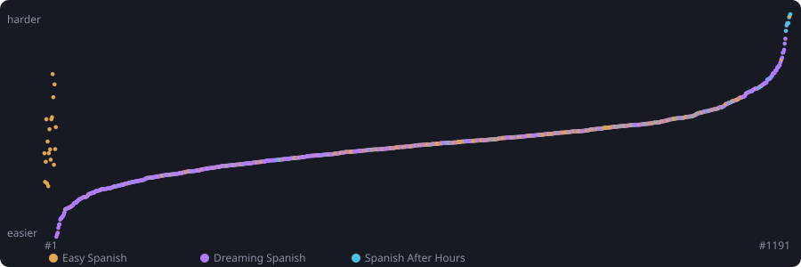

# spanish-immersion-path

A path through Spanish immersion videos on YouTube, ordered from easiest to hardest,
with an Anki deck that teaches the words of each video right after you watch it.

- [Progress page](https://tieo.github.io/spanish-immersion-path/): the difficulty curve
  and every video with its level, speed and number of new words; tick off what you have
  watched (stored in your browser)
- [Playlist on YouTube](https://www.youtube.com/playlist?list=PLHH8jQ4Q3nHE)

## The playlist

1,176 videos from three channels that teach through native speakers talking, not
through lessons:

- [Easy Spanish](https://www.youtube.com/@easyspanish): street interviews and the slow
  *Super Easy Spanish* conversations
- [Dreaming Spanish](https://www.youtube.com/@DreamingSpanish): comprehensible input
  from superbeginner to advanced
- [Spanish After Hours](https://www.youtube.com/channel/UCfG2VhlQgy5bHGmkpeKcjVA): slow
  vlogs and stories

Grammar lessons, vocabulary lists, videos in English, promos and compilations of other
videos are left out.

Dreaming Spanish labels each of its videos superbeginner, beginner, intermediate or
advanced. Six measures from each video's Spanish captions are fitted to those labels, and
the fit places every video, from all three channels, on the same scale:

- **speed**: syllables per second, pauses included
- **sentence structure**: subordinate clauses per word
- **verb forms**: share of verbs in a past tense
- **vocabulary**: share of words outside the 3,000 most common Spanish words, and how
  many different words are used
- **pronouns**: object pronouns (lo, le, se) per word

Speed carries most of the weight. Scored by a fit that has not seen them, the labelled
videos come out in the order of their labels with a rank correlation of 0.78. The curve
above shows every video as a bar along the hours of the playlist, as wide as the video
is long and as high as its level. The playlist runs in rising order of that score.

## The Anki deck

Each video gets a sub-deck of new words: the most widespread words of the playlist that
the video contains and no earlier video has taught yet, 30 per video and up to 40 when
the extra words come back nowhere later. The early videos fill that quota; further along,
most of what a video says has been taught already, so later videos bring a handful of new
words each (11,882 cards in all). The progress page can hide videos below a number of new
words. Words easier than a
video's cards were taught by earlier videos; the most common words, which make up half
of everything said, are taken as known. A card shows the word with its pronunciation
(IPA and a recording, Spain and Latin America), the meaning, a sentence from the video
with its translation, a link to that moment in the video, and links to the next videos
where the word comes back.

## Building it

The pipeline lives in `pipeline/`, the inputs it decides on in `data/`; everything
derived (captions, vocabulary, recordings, the deck) goes to `build/`, which stays out of
the repository because the captions are the channels' text.

1. `fetch_captions.py`: Spanish captions of every video (yt-dlp with browser cookies)
2. `levels.py`: scores and watching order, written to `data/order.json`
3. `words.py`: the words of each video, then `translate.py batches` and `merge` around
   the translators that follow `TRANSLATE.md`; rerun `words.py` after a merge so videos
   that lost dropped words refill
4. `ipa.py`, `audio.py`: pronunciation and recordings for Spain and Latin America
5. `deck.py`: `build/deck.apkg`, one sub-deck per video
6. `ankiweb.py push`: imports the deck into an AnkiWeb account, keeping review history
7. `site_data.py`: the data behind the progress page
8. `progress.py`: per-video Anki progress for the page, read from AnkiWeb; the Pages
   workflow runs it every three hours when the repository has an `ANKIWEB_HKEY` secret
9. `units.py`: `data/units.json`, the catalog the learner's app picks units from
10. `placement.py`: `build/placement.json`, words and clips for the app's placement test

## The learner's app

`server/` is a small web app (`python -m server.app`) that picks the next unit instead
of a fixed order: a placement test sets the starting level from word recognition and
from writing down clips of rising difficulty; every finished unit is rated easy, just
right or hard, which moves the level, and can be marked boring, which steers away from
its series. Modes choose what fits the moment: the best next step, audio only, or
something relaxed. Anki holds every word of the path in one deck, suspended until a
video the learner finished introduces it. Claude can hold a spoken practice
conversation through the app's MCP endpoint, which hands it the learner's level, the
words they are learning and their recurring errors.
